**Computer Science Graduate from Egypt 🇪🇬 · AI Engineer · Motion Graphics 🎬**

---

## 🧑‍💻 About Me

- 🤖 I build **local, private Arabic AI**: assistants that run fully on your own machine with open models on Ollama, with no data leaving the device
- 🛠️ I design **LLM agents** that use tools safely: strict JSON planning, sandboxed tools, and no destructive actions
- 🧪 I measure instead of guessing: every prompt or design change is tested with **evals** across seeds
- 🔐 I bring my **Cyber Security** background to AI: prompt-injection testing and agent safety
- 🎬 I create **motion graphics and educational explainer videos**, built with AI (Claude)
- ⚡ Fun fact: I love solving problems more than writing code 😎

## 🚀 Featured Project

<table>
<tr>
<td>

### [🦉 SAHIR · ساهر](https://github.com/IsllamAmr/SAHIR)

A **local, private Arabic AI assistant**: chat, voice, a tool-using agent, and email, all on a laptop GPU.

- 🎙️ **Voice:** push-to-talk with faster-whisper and Piper; Saher starts speaking **~2.3 s** after you let go
- 🛠️ **Agent:** reads PDF, Word and Excel files, calculates, writes new reports, and reads email through n8n
- 🧠 **Planner + writer architecture:** ALLaM 7B picks tools as strict JSON, and a separate persona writes the reply
- 🔐 **Prompt-injection guard:** without it the model obeyed a malicious file **3/3** times; with it, **0**
- 📊 **Evals:** improved from **6/14 to 42/42** on Saudi and Egyptian dialect tasks

`ALLaM 7B` `Ollama` `Python` `faster-whisper` `Piper TTS` `n8n` `JSON schema`

</td>
</tr>
</table>

## 🛠️ Tech Stack

**🤖 AI & LLMs**

  
  
  
  
  
  
  

**🔐 Security & Automation**

  
  
  

**💻 Languages & Tools**

  

**🎬 Content**

  
  

Also worked with: Flutter · Dart · Firebase · Supabase · Node.js

## 📁 Earlier Work

| Project | Description | Tech |
|---|---|---|
| [**Evara BNS**](https://github.com/IsllamAmr/Evara-BNS) | Employee attendance system | Supabase · Node.js |
| [**E-Exam System**](https://github.com/IsllamAmr/amr-shaaban) | Online exams with a teacher dashboard for results and question banks | Firebase |
| [**Noon Chat**](https://github.com/IsllamAmr/noon_chat) | Real-time chat app | Flutter · Firebase |
| [**Movies Site**](https://github.com/IsllamAmr/movies-site) | Movie browsing website | TMDB API · JavaScript |
| [**Portfolio**](https://github.com/IsllamAmr/Portfolio) | Personal portfolio, [live here](https://isllamamr.github.io/Portfolio) | HTML · CSS · JS |

## 📊 GitHub Stats

  
  

  

  <picture>
    <source media="(prefers-color-scheme: dark)" srcset="https://raw.githubusercontent.com/IsllamAmr/IsllamAmr/output/github-snake-dark.svg" />
    <source media="(prefers-color-scheme: light)" srcset="https://raw.githubusercontent.com/IsllamAmr/IsllamAmr/output/github-snake.svg" />
    
  </picture>

---

*"Turning coffee into bugs... wait, I mean code."* ☕🐛

